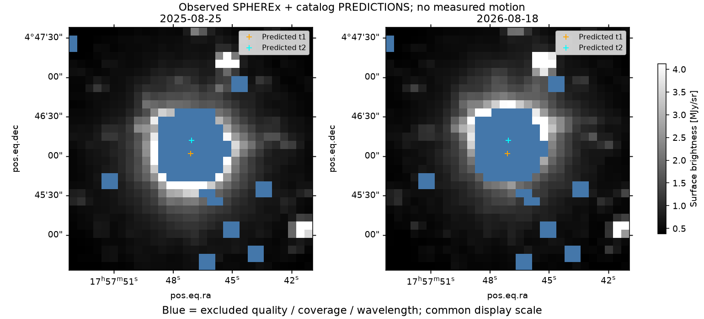
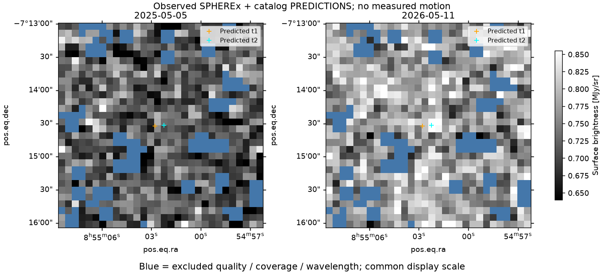

# M4 — Viabilidad científica de nuevos objetivos SPHEREx

Investigación del plan aprobado, ejecutada el **14 de noviembre de 2026**. El
resultado es una evaluación de observaciones reales y posiciones de catálogo
**predichas**. No se midió movimiento, no se identificó una nueva fuente y no se
hace ninguna afirmación de descubrimiento de Planet X.

## Método reproducible

El nuevo CLI `server/spherex/research.py` reutiliza sin modificar descubrimiento,
lectura FITS, máscaras conservadoras, selección espectral y reproyección de M1.
El frontend, contrato HTTP, servicio M101 e inicialización Docker no cambian.
Los productos de investigación se guardan en `server/outputs/m4/`, ignorado por
Git, y los de M101 siguen en su directorio habitual.

Desde `server/`:

```bash
uv run --locked python -m spherex.research --timeout 20
uv run --locked python -m spherex.research --offline
# Alternativa opcional, después de las campañas principales:
uv run --locked python -m spherex.research --targets lalande21185 --max-downloads 12 --timeout 20
uv run --locked python -m spherex.research --targets lalande21185 --max-downloads 12 --offline
uv run --locked python scripts/summarize_m4.py --output ../docs/m4-evidence.json
uv run --locked pytest -q
```

`--offline` exige los mismos parámetros espaciales, temporales y de muestreo.
No descarga los productos que fallaron en vivo: conserva explícitamente la
clasificación incompleta y permite reproducir los pares de los productos que sí
se adquirieron. Cada ejecución completa conserva su manifiesto en `runs/`.
Un XML con `ERROR` o `OVERFLOW`, un fallo HTTP o un catálogo inaccesible nunca
se interpreta como ausencia de observaciones. Las respuestas brutas, URL,
fecha de adquisición, hash SHA-256, filas y duración quedan registradas.

Se consulta DR1 y QR3 con SIA2, `MAXREC=1000`, intervalo MJD 60676–61406
(2025-01-01 a 2027-01-01), y un cono pequeño que cubre la trayectoria predicha
más un margen de 36 arcsec. Se deduplican URLs de producto; releases diferentes
se conservan separadas. Los FITS verifican OBSID, detector, DATE-OBS/MJD-OBS,
unidades, WCS TAN-SIP, varianza y flags. `DATE` no se usa como época de observación.
Las longitudes de onda locales proceden de WCS-WAVE, aproximado para visualización.

Se eligen hasta dos detectores por candidato principal y uno por alternativa,
con muestreo determinista que abarca toda la serie temporal. Límites: 24
productos por detector, 192 productos y 2 GiB de productos adquiridos en toda
la caché M4; 16 MiB por archivo, límites M1 por caché/directorio y respuesta,
timeouts y descargas secuenciales. Un bloqueo entre procesos impide campañas
simultáneas en el mismo directorio. Agotar un presupuesto significa investigación
incompleta. No se amplía el muestreo cambiando los límites hasta obtener un éxito.

Cada candidato tiene **un único centro celeste fijo**, calculado de la trayectoria
2025–2027, para todas las épocas y detectores. No se recentra sobre la fuente.
Los cutouts nativos tienen el doble del lado del campo comparado de 3 arcmin;
la cuadrícula común usa la escala nativa mayor. Los umbrales permanecen:

- Separación ≥30 días.
- Cobertura común válida y espectralmente compatible ≥80% de la cuadrícula.
- Desfase espectral ≤0,25 anchos de banda y razón de anchos ≤1,2.
- Rechazo de todos los bits excepto SOURCE y FULLSAMPLE, también bits desconocidos.

Se registran **todos** los pares y rechazos, también después del primer par
aceptado. Las posiciones predichas se verifican contra la máscara común y las
máscaras nativas. El diagnóstico local registra flags, fracción válida dentro
de un radio de una FWHM (mínimo un píxel), mediana de fondo entre dos y tres
radios, varianza del píxel nativo y contraste/fondo dividido por su sigma nativa.
Esto **no es SNR fotométrica calibrada**, ni prueba de identificación o ausencia
de confusión. No se propaga varianza con la interpolación bilineal.

## Astrometría y selección de detectores

El registro versionado es `server/spherex/data/m4-targets.json`; no se emplean
presets del frontend. ICRS no tiene equinoccio: la época de **posición** se
transmite a `SkyCoord.obstime`. El movimiento en RA es siempre
`pm_ra_cosdec = dα/dt cos δ`, en mas/año.

| Objetivo | Posición de referencia (grados) y época | μα* / μδ (mas/año) | Paralaje / RV | Detectores |
|---|---|---|---|---|
| Barnard | 269.44850252543836, +4.739420051112412; J2016.0 TCB | −801.550978 / +10362.394207 | 546.975940 mas; −110.46822 km/s | D2, D6 |
| WISE 0855−0714, componente móvil | 133.787085, −7.244451; MJD 56677.3 UTC | −8060 / +700 | 454 mas; RV desconocida | D6, D5 |
| Epsilon Indi Ba/Bb | Requiere fila 2MASS J22041052−5646577 y su `jdate` | +3987.41 / −2505.35 | 274.99 mas; RV no adoptada | D2, D6 |
| Lalande 21185, alternativa | 165.83095967577933, +35.948653032660104; J2016.0 TCB | −580.057087 / −4776.588719 | 392.752945 mas; −85.11064 km/s | D2 |

Barnard se verificó mediante consulta real a **Gaia DR3
4472832130942575872**. Incertidumbres 1σ: RA 0,02624 mas, Dec 0,02904 mas,
μα* 0,03182 mas/año, μδ 0,03607 mas/año, paralaje 0,04012 mas y RV
0,13126 km/s. La consulta ADQL exacta se conserva en el registro; usa
`gaiadr3.gaia_source` en el [archivo oficial Gaia](https://gea.esac.esa.int/archive/).
D2 y D6 son muestras exploratorias de una enana M cercana; ninguna elección
presupone que los píxeles de la estrella sean utilizables.

WISE usa las tablas 1 y 2 de [Luhman 2014](https://arxiv.org/html/1404.6501v1).
Incertidumbres: posición 0,04 arcsec, μα* 90 mas/año, μδ 70 mas/año y paralaje
45 mas. La posición de Spitzer es **observada**, no el origen baricéntrico de
un ajuste: retiene un desfase paraláctico desconocido de hasta aproximadamente
0,454 arcsec. Las incertidumbres antiguas de movimiento acumulan del orden de
1–2 arcsec hasta 2026. Se trata la astrometría J2000, calibrada con 2MASS, como
ICRS para esta visualización aproximada. La mayor emisión publicada en [4.5]
que en [3.6], junto al límite J, motiva priorizar D6 y después D5; no se convierten
magnitudes IRAC en flujos SPHEREx. Las fuentes estacionarias mezcladas documentadas
por ese trabajo impiden equiparar un píxel brillante con WISE 0855.

Epsilon B usa el movimiento baricéntrico y paralaje de la tabla 4 de
[Chen et al. 2022](https://arxiv.org/html/2205.08077v1), con errores 0,12 y
0,10 mas/año y 0,43 mas. La posición y época deben proceder de la fila
[2MASS PSC](https://irsa.ipac.caltech.edu/data/2MASS/docs/releases/allsky/doc/sec2_2a.html),
no de Epsilon Indi A ni de las cifras truncadas del nombre. Ba/Bb tienen
separación subarcsec y se consideran potencialmente **no resueltos** a la escala
SPHEREx. Propagar un fotocentro 2MASS con movimiento baricéntrico no modela las
órbitas de los componentes. D2 y D6 son elecciones exploratorias para el sistema T.

`Astropy.apply_space_motion` incluye perspectiva cuando se suministran distancia
y RV (Barnard; Lalande cuando Gaia la proporciona). RV desconocida se fija
explícitamente a cero, sin inferir una medida. No se modelan paralaje anual del
observador, órbitas ni covarianzas; las incertidumbres y errores de anclaje no
se eliminan por usar Astropy. Para estas fuentes próximas, una predicción ICRS
no sustituye un ajuste astrométrico de imágenes.

## Estado de adquisición y resultado científico

Las consultas principales terminaron con `QUERY_STATUS=OK`: Barnard DR1
240 filas y QR3 124; WISE DR1 258 y QR3 0. Ese cero es un resultado válido
**sólo de esa consulta QR3**, no un fallo remoto. Epsilon Indi B se bloqueó
antes de SIA2: el catálogo 2MASS devolvió HTTP 502 después de dos intentos;
no se adoptó una posición ni época inventada. El identificador y movimiento
bibliográfico por sí solos no autorizan una comparación de imágenes.

Barnard tiene dos pares de campo comparables. Sus píxeles predichos contienen
`OVERFLOW` y `BLOOM`, y D2 también `SUR_ERROR`. La fuente no es evaluable con
las máscaras actuales. No se relajaron esos flags aunque el desplazamiento
predicho sea del orden de un píxel o mayor.

WISE tiene tres pares de campo comparables. El D6 de 2025-05-05 / 2026-05-11
retiene 84,556% de cobertura; las longitudes de onda aproximadas son
4,967421 / 4,967311 µm. Los píxeles de ambas posiciones predichas son válidos,
pero los contrastes respecto al fondo sobre sigma nativa son sólo 1,39 y 1,11;
no demuestran una señal utilizable para medir movimiento. La confusión no
queda descartada. Dos pares D5 tienen desplazamientos de apenas 0,76–0,78
arcsec (menos de 0,1 FWHM): sus limitaciones de escala/cadencia son distintas
de las del D6 anual. Una geometría potencialmente evaluable no es una detección.

El centro WISE de M4 es aproximadamente 133,760122°, −7,242127°, propagado
a la ventana 2025–2027. No es la coordenada fija 133,7951°, −7,2451° del ensayo
M1. Por eso el resultado comparable M4 no sustituye ni contradice el rechazo
M1 de 78,667%: son regiones y muestreos distintos con los mismos umbrales.

Lalande se verificó con Gaia DR3: errores de posición RA/Dec 0,02413 / 0,02937
mas, errores μα*/μδ 0,02557 / 0,03003 mas/año, paralaje 0,03207 mas y RV
0,13100 km/s. Sus consultas devolvieron DR1 267 y QR3 30 filas. En la muestra
D2 de 12 intentos, 11 FITS fueron inspeccionados y todos tuvieron posición
predicha nativa inválida. Los dos pares que pasaron la preselección espectral
tenían sólo 44,889% y 69,444% de cobertura común compatible: resultado negativo
**dentro de esa muestra**, además de la limitación local y del fallo de una
descarga. Se eligió una de las dos alternativas permitidas; Luhman 16 no se
evaluó y no se emite un resultado sobre él.

La clasificación orientativa para continuar es: WISE D6 primero por geometría
y píxeles válidos, pero señal/confusión pendientes; Barnard después sólo como
ejemplo de rechazo de calidad, aunque sus campos sean comparables; Lalande
negativo en la muestra; Epsilon B bloqueado sin clasificación de datos SPHEREx.
**Ninguno queda validado como demostración de movimiento observado.**

## Pares, adquisición y evidencia verificable

El resumen [en vivo](m4-evidence-live.json) conserva los errores remotos reales;
el [resumen reproducido offline](m4-evidence.json) incluye flags locales y métricas
de pares reproyectados rechazados. Ambos contienen URL completas, tiempos, hashes,
IDs y metadatos por producto. Las cifras siguientes se extraen de esos manifiestos.

| Objetivo / detector | Candidatos | Intentos / FITS inspeccionados | Posiciones nativas válidas | Pares evaluados / aceptados |
|---|---:|---:|---:|---:|
| Barnard's Star / D2 | 62 | 24 / 18 | 0 | 153 / 1 |
| Barnard's Star / D6 | 60 | 24 / 20 | 0 | 190 / 1 |
| Lalande 21185 / D2 | 52 | 12 / 11 | 0 | 55 / 0 |
| WISE 0855−0714 / D6 | 45 | 24 / 22 | 22 | 231 / 1 |
| WISE 0855−0714 / D5 | 48 | 24 / 22 | 21 | 231 / 2 |

| Objetivo / detector | OBSID t1 → t2 | Fechas UTC | λ aproximada (µm) | Δt (días) | Cobertura | Desplazamiento predicho: arcsec / píxeles / FWHM |
|---|---|---|---|---:|---:|---|
| barnard D2 | `2025W35_1A_0146_1` → `2026W34_1A_0363_1` | 2025-08-25T17:08:22.267 → 2026-08-18T20:48:38.781 | 1.516589 / 1.511483 | 358.152969 | 89.111% | 10.204 / 1.660 / 1.368 |
| barnard D6 | `2025W33_2C_0321_1` → `2026W12_2A_0520_4` | 2025-08-15T20:45:11.337 → 2026-03-22T08:50:47.183 | 4.928703 / 4.929960 | 218.503887 | 81.111% | 6.225 / 1.010 / 0.688 |
| wise0855 D6 | `2025W19_1B_0116_1` → `2026W20_1A_0033_1` | 2025-05-05T16:48:02.459 → 2026-05-11T02:18:44.662 | 4.967421 / 4.967311 | 370.396322 | 84.556% | 8.204 / 1.331 / 0.907 |
| wise0855 D5 | `2025W45_2A_0278_3` → `2025W50_2A_0164_1` | 2025-11-07T18:51:31.958 → 2025-12-12T01:48:37.977 | 4.082230 / 4.082024 | 34.289653 | 80.667% | 0.760 / 0.123 / 0.088 |
| wise0855 D5 | `2025W45_2A_0292_1` → `2025W50_2A_0391_1` | 2025-11-07T20:29:18.310 → 2025-12-12T21:24:46.123 | 4.153110 / 4.153093 | 35.038516 | 81.111% | 0.776 / 0.126 / 0.090 |

Los cinco pares usan cuadrículas TAN ICRS de 30×30, Norte arriba y Este a la
izquierda (FITS con origen inferior). Las cabeceras WCS completas de cada
comparación constan en los JSON; los encabezados nativos están en los manifiestos
locales. No se ha aplicado recentrado individual ni homogeneización de PSF.





Se intentaron 108 productos en las muestras finales: 93 FITS inspeccionados y
15 fallos de descarga. La caché conserva 95 productos (379.759.680 bytes,
aproximadamente 362,2 MiB), incluidos dos de una invocación inicial interrumpida
de la alternativa, ajenos al último muestreo. Esa invocación había coincidido
brevemente con la principal: se detuvo y se añadió un bloqueo entre procesos
antes de ejecutar la alternativa completa. Los dos productos previos se incluyen
en el presupuesto global y en `products_not_in_latest_sample`; no se usan para
inflar la muestra. No se agotó el presupuesto. FITS, XML y cachés no se incorporan a Git.

## Verificación ejecutada

- `uv run --locked pytest -q`: **67 passed**, una advertencia preexistente de
  Starlette/httpx. Incluye 20 pruebas M4 de propagación, coseno en RA, wrap,
  épocas, identidad de catálogo, deduplicación, límites, máscaras, estados SIA,
  bloqueo de campañas, conservación de umbrales y replay sin red.
- `uv run --locked python -m compileall -q spherex scripts/summarize_m4.py`: pasó.
- Campaña principal en vivo: salida **3**, cinco pares; incompleta por fallos
  remotos y bloqueo 2MASS. Alternativa: salida **3**, cero pares y un fallo de descarga.
- Replays offline con los parámetros documentados: salida **3**; reprodujeron
  exactamente los cinco conjuntos de IDs, coberturas y desplazamientos predichos.
  Los fallos HTTP de la ejecución original pasan a ser faltas de caché explícitas.
- M101 se preparó con el CLI existente (`python -m spherex.prepare --output
  outputs/m101 --timeout 30`): salida **0**, par original reproducido pese a
  fallos transitorios en otros productos. `GET /frames` verificado por TestClient:
  **HTTP 200**, IDs `2026W20_2A_0464_3` / `2026W26_1A_0500_1`, 769/900 píxeles
  válidos. SHA-256 de `outputs/m101/aligned.fits`:
  `775134edcb9c5f66602d84cdbb9c3f8945ba0c9a56cb36fa3f9c6c43fa94e19c`.
- Se inspeccionaron visualmente las figuras de Barnard y WISE D6, con máscara
  azul, escala compartida y leyendas de posiciones **predichas**. No se ejecutaron
  checks nuevos del frontend o Docker porque sus archivos y comportamiento no cambian.

Para reexportar la evidencia actual desde `server/`:

```bash
uv run --locked python scripts/summarize_m4.py --output ../docs/m4-evidence.json
```
Las ejecuciones históricas completas están en `outputs/m4/**/runs/`.

## Registro propuesto de datasets

El registro de candidatos astrométricos anterior **no** constituye un registro
de datasets publicables. Una extensión posterior puede guardar entradas
pequeñas con `id` estable, `directory`, `region` (centro, campo y WCS común),
`epochs` (OBSID, fecha UTC/MJD), `detector`, `provenance` (colecciones, URLs,
hashes y procesamiento) y `validation` (cobertura, compatibilidad y limitaciones).
Una entrada sólo se promovería tras verificar sus archivos y documentar por
separado la calidad de la fuente; una región comparable no implica movimiento
observable. M101 seguirá siendo el dataset predeterminado del contrato actual.
La selección explícita de otro dataset y nuevos endpoints quedan fuera de M4.

Referencias del método: [acceso oficial SPHEREx](https://caltech-ipac.github.io/spherex-archive-documentation/spherex-data-access/),
[productos oficiales](https://caltech-ipac.github.io/spherex-archive-documentation/spherex-data-products/),
[Astropy: propagación temporal](https://docs.astropy.org/en/stable/coordinates/apply_space_motion.html).

Ejemplo de entrada propuesta, construido con los metadatos M101 verificados
en esta sesión; no se implementa ni activa todavía un selector de datasets:

```json
{
  "id": "m101-qr3-d2-2026",
  "directory": "outputs/m101",
  "region": {
    "ra_deg": 210.80227,
    "dec_deg": 54.34895,
    "fov_arcmin": 3.0
  },
  "epochs": [
    {
      "obs_id": "2026W20_2A_0464_3",
      "date_obs_utc": "2026-05-17T10:58:03.117",
      "mjd_obs": 61177.456980521
    },
    {
      "obs_id": "2026W26_1A_0500_1",
      "date_obs_utc": "2026-06-24T03:19:00.063",
      "mjd_obs": 61215.138195174
    }
  ],
  "detector": 2,
  "provenance": {
    "manifest": "manifest.json",
    "aligned_file": "aligned.fits"
  },
  "validation": {
    "level": "field_visualization",
    "motion_measured": false
  }
}
```
